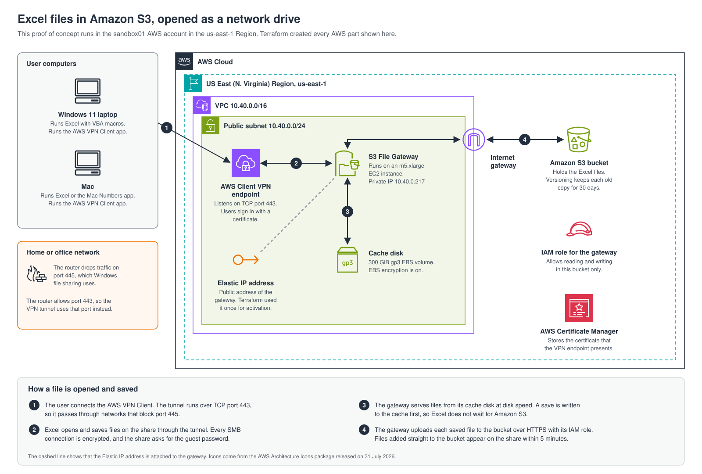
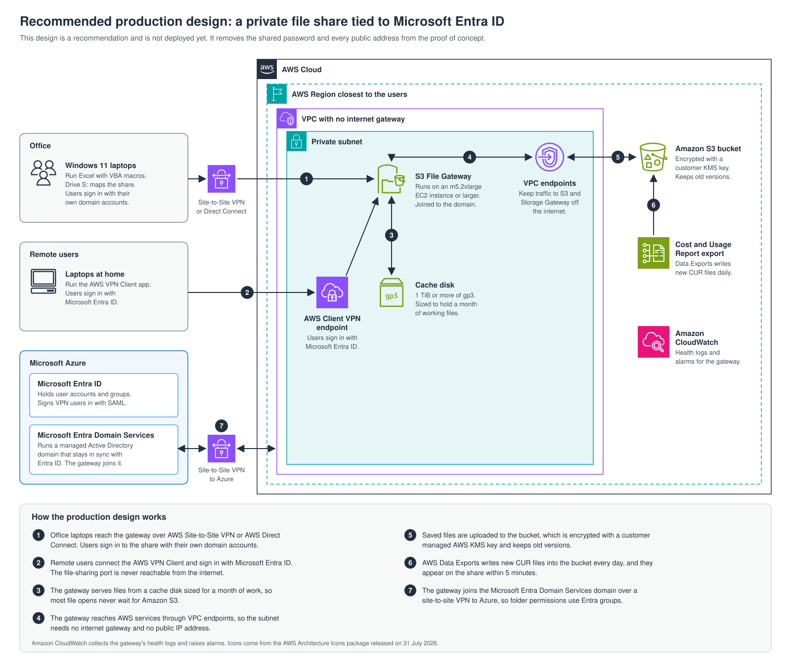

<div align="center">

# CUR Excel Files on an S3 Network Drive with Amazon S3 File Gateway

_DRAFT - For internal use only. Last modified: 2026-11-25 11:40 EST by mbitar._

**Excel users on Windows 11 and macOS open, edit and save Cost and Usage Report workbooks that are stored in Amazon S3, through an ordinary network drive. The AWS service that turns the S3 bucket into that network drive is Amazon S3 File Gateway, one type of AWS Storage Gateway.**


</div>



## Live demo

This recording of a real run copies a workbook to the share, follows it into S3, compares checksums, saves an edited version, and shows a file written straight to S3 appearing on the share. Every step succeeded, and the whole run took 32 seconds. The [demo page](docs/demo.md) has the full transcript.



## The problem

Cost and Usage Report (CUR) workbooks live in Amazon S3. The analysts who use them work in Excel on Windows 11 laptops and run VBA macros on files that can hold millions of rows. Excel cannot open files straight from S3, because S3 is object storage reached through web requests, not a file system.

## The solution

**Amazon S3 File Gateway**, one type of **AWS Storage Gateway**, runs on EC2 and presents the S3 bucket as a Windows file share. Each file on the share is one object in the bucket. Excel opens and saves files on the share like on any network drive. The gateway keeps recently used files on a fast local cache disk and uploads every save to S3 in the background. **AWS Client VPN** carries the file-sharing traffic over TCP port 443, because many networks block the file-sharing port 445.

The [architecture page](docs/architecture.md) explains how a file is opened and saved, and why each part was chosen.

## At a glance

| Question | Answer |
|---|---|
| Which AWS service turns S3 into a network drive? | Amazon S3 File Gateway, one type of AWS Storage Gateway. It runs on an EC2 instance and shares the S3 bucket over SMB, the Windows file-sharing protocol. |
| Where do the files live? | In an S3 bucket with encryption, versioning and a 30-day cleanup rule for old versions. |
| What do users install? | The free AWS VPN Client app. The share itself is an ordinary mapped drive. |
| Does Excel's lock prompt work? | Yes, for users of the same gateway. A second user is offered a read-only copy. |
| How fast is it? | The [114 MB workbook](docs/test-results.md#large-workbook-test-the-114-mb-file) copied from the share in 21 seconds over a 65 Mbit/s home connection. Files in the gateway's cache open at disk speed. |
| What does it cost? | About $277 a month for the proof of concept, and about $615 to $655 for the production design. See [Costs](docs/costs.md). |
| Is it deployed? | No. It ran in the sandbox01 account in us-east-1 and was removed on 23 November 2026. The quick start below deploys it again. |

## Proof of concept and production

The proof of concept shows that the idea works, and it accepts weaknesses that real cost data must not be exposed to. The production design is meant to fix them. It is a recommendation, and it has not been built or tested.

| Area | Proof of concept | Production design |
|---|---|---|
| Status | Deployed and tested from a Mac, and since removed. Excel on Windows 11 was not tested. | Not built or tested. |
| Sign-in to the share | Everyone uses one shared guest password. | Each user signs in with their own account, through Microsoft Entra Domain Services. |
| Folder permissions | Everyone can read and change every file. | Windows folder permissions are granted to Microsoft Entra ID groups. |
| Sign-in to the VPN | Everyone uses one shared client certificate. | Each user signs in with Microsoft Entra ID, so disabling an account removes its access. |
| How users connect | All users connect through AWS Client VPN. | Remote users connect through AWS Client VPN. The office connects through AWS Site-to-Site VPN or AWS Direct Connect. |
| Exposure to the internet | The gateway has a public IP address, and its file-sharing port is open only to the listed addresses. | The gateway has no public IP address, and its network has no internet gateway. |
| Path from the gateway to S3 | Encrypted traffic crosses the internet. | Traffic stays inside AWS, through VPC endpoints. |
| Outbound traffic from the gateway | All traffic is allowed. | Only the traffic that the gateway needs is allowed. |
| Encryption keys | AWS manages the keys. | A customer managed AWS KMS key encrypts the bucket and the disks. |
| Gateway size | An m5.xlarge instance with a 300 GiB cache. | An m5.2xlarge or larger instance with a cache of 1 TiB or more. |
| Logging and alarms | Both are off. | Connections, network traffic, file access and gateway health are logged, and CloudWatch alarms are set. |
| Monthly AWS cost | About $277 in fixed charges. Charges that depend on use are extra. | About $615 to $655 for 10 users, including typical use. Microsoft's charges for Entra Domain Services and the Azure VPN gateway are extra. |

[](docs/production.md)

Compare this diagram with the proof-of-concept diagram at the top of the page. The [production design page](docs/production.md) has the full comparison and the steps to build it, the [security page](docs/security.md) explains each weakness it fixes, and the [costs page](docs/costs.md) itemizes both totals.

## Quick start

1. Sign in to AWS with `aws sso login --profile sandbox01`.
2. In `terraform/`, copy `terraform.tfvars.example` to `terraform.tfvars` and fill in the bucket name and your public IP address.
3. Run `terraform init`, then `terraform plan -out=poc.tfplan`, then `terraform apply poc.tfplan`.
4. Install the AWS VPN Client, import the profile file that Terraform wrote, and connect.
5. Map the share with `scripts/connect-windows.ps1` on Windows, or `scripts/connect-macos.sh` on a Mac.

The [deployment guide](docs/deployment.md) has every step, including how to close the activation port and how to remove everything.

## Documentation

| Guide | What it covers |
|---|---|
| [Architecture](docs/architecture.md) | How opening and saving a file works, the design decisions, and the limits that remain. |
| [Deployment guide](docs/deployment.md) | Deploying, handing out access, and removing the proof of concept. |
| [Windows 11 production PC](WINDOWS11_PROD_PC.md) | Whether the proof of concept can run on a production Windows 11 PC, what needs a Windows administrator, and checks to paste into the PC. |
| [Connect from Windows 11](docs/connect-windows.md) | Installing the VPN app, mapping drive S:, and tips for large workbooks. |
| [Connect from macOS](docs/connect-macos.md) | Opening the share in Finder, and saving from Excel and the Mac Numbers spreadsheet app. |
| [Security](docs/security.md) | The protections in place, the weaknesses accepted for the proof of concept, and where each secret lives. |
| [Costs](docs/costs.md) | Monthly costs for the proof of concept, the production design and the alternatives. |
| [Pros and cons](docs/pros-and-cons.md) | This approach compared with FSx for Windows, WorkSpaces, desktop mount tools and Athena. |
| [Live demo](docs/demo.md) | A recorded end-to-end run, with the full transcript and how to run it again. |
| [Test results](docs/test-results.md) | Every test run so far, with measured results. |
| [Test plan](docs/test-plan.md) | The scenarios that have not run yet. They need a new deployment. |
| [Troubleshooting](docs/troubleshooting.md) | Symptoms, causes and fixes for the problems found during testing. |
| [Production design](docs/production.md) | A private, per-user design tied to Microsoft Entra ID. |

## Test results so far

| Area | Result |
|---|---|
| **Large workbook, the 114 MB file** | **The copy from the share took 20.8 seconds, against 15 seconds straight from S3. The Mac Numbers spreadsheet app took about 3 minutes to open it, mostly spent converting it. See the [large workbook results](docs/test-results.md#large-workbook-test-the-114-mb-file).** |
| Terraform security tests | 13 of 13 passed. |
| Python tool tests | 16 of 16 passed. |
| Deployment | 41 resources created. The activation port was closed afterwards. |
| Live demo | Every step succeeded. A 6.5 MB workbook reached S3 within 1 second of the copy finishing, and its checksum matched. |
| Share over the public internet | Blocked by the test network, which drops port 445. |
| Share through the VPN | Works, with SMB 3.1.1 and AES-128-GCM encryption. |
| Save from macOS | Works. S3 kept the previous version. |
| Windows 11 with Excel and VBA | Not tested. The deployment was removed first. It is the first block of the [test plan](docs/test-plan.md). |
| Removal | Terraform deleted all 40 resources, and a check found nothing left in the account. |

## Repository layout

```text
.
├── README.md                       This page
├── LICENSE                         Proprietary license from FPT, the solution owner
├── DISCLAIMER.md                   Disclaimers that form part of the license
├── NOTICE.md                       Third-party material and its terms
├── WINDOWS11_PROD_PC.md            What a production Windows 11 PC needs, with checks
├── docs/                           Guides, explanations and results
│   ├── demo/                       Animated demo and the recording it is built from
│   ├── diagrams/                   Finished diagrams in SVG and PNG
│   │   └── src/                    Diagram sources and the AWS icons they use
│   └── *.md                        One page per topic, listed above
├── terraform/                      Everything Terraform creates
│   ├── main.tf                     Network, bucket, IAM role, gateway and file share
│   ├── vpn.tf                      Certificates, Client VPN endpoint and VPN profile file
│   ├── variables.tf                Settings, with checks on allowed values
│   ├── outputs.tf                  Addresses, commands and the guest password
│   └── tests/                      Security tests that run without an AWS account
├── scripts/                        Drive-mapping scripts and the live demo
├── tools/                          SMB probe, sample workbook, diagram and demo builders, date stamper
├── tests/                          Tests for the Python tools
└── .github/workflows/ci.yml        Checks that run on every push and pull request
```

## Working on this repository

Run the Terraform tests, which need no AWS account:

```bash
cd terraform && terraform init -backend=false && terraform test
```

Run the Python tool tests:

```bash
python3 -m unittest discover -s tests
```

Rebuild the diagrams after editing a file in `docs/diagrams/src/`. The builder needs Google Chrome, and it fails if any text is clipped or overlaps:

```bash
python3 tools/build_diagrams.py
```

Update the stamp at the top of each document you changed. The stamp marks the document as a draft for internal use, and records the date, time and the person who changed it. Use `--by` to give a different name:

```bash
python3 tools/stamp_docs.py README.md docs/architecture.md
```

## Credits

The diagrams use the [AWS Architecture Icons](https://aws.amazon.com/architecture/icons/), released by AWS on 31 July 2026, under AWS's terms for use in architecture diagrams.

## License and disclaimers

This repository is a draft for internal use only. It is proprietary and confidential, and it is not open source. FPT owns this solution. Nobody may use, copy, change or share any part of it without FPT's written permission.

| File | What it says |
|---|---|
| [LICENSE](LICENSE) | The proprietary license. It grants no rights, and it excludes every warranty and all liability. |
| [DISCLAIMER.md](DISCLAIMER.md) | The disclaimers about cloud costs, cost estimates, test results, security, data loss and trademarks. They form part of the license. |
| [NOTICE.md](NOTICE.md) | The third-party material in this repository and the tools it uses, with the terms that cover each. |

---

_DRAFT - For internal use only. Proprietary and confidential. FPT owns this solution. See the [license](LICENSE) and the [disclaimers](DISCLAIMER.md)._
