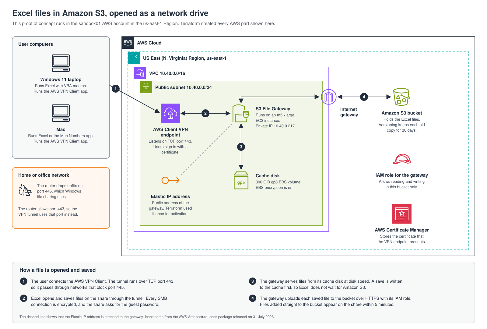

# Architecture

_DRAFT - For internal use only. Last modified: 2026-11-23 11:42 EST by mbitar._

This page explains how the proof of concept lets Excel users open, edit and save files that are stored in Amazon S3, and why it is built this way.

[Back to the README](../README.md)

## The problem

Cost and Usage Report (CUR) workbooks are stored in Amazon S3. The analysts who use them work in Excel on Windows 11 laptops and run VBA macros against the data. Excel cannot open files straight from S3, because S3 is object storage reached through web requests, while Excel expects a file system. Some workbooks are several hundred megabytes and hold millions of rows.

## The solution in one paragraph

AWS Storage Gateway in its S3 File Gateway form runs as an EC2 instance and presents an S3 bucket as a Windows file share. Each file in the share is one object in the bucket. Excel opens and saves files on the share like on any network drive. The gateway keeps recently used files on a local cache disk and uploads every saved file to S3 in the background. Users reach the gateway through AWS Client VPN, which carries the file-sharing traffic over TCP port 443, because many home and office networks block the file-sharing port 445.

## How a file is opened

1. The user connects the AWS VPN Client app, which signs in to the Client VPN endpoint with a certificate. The laptop gets an address from the range 10.50.0.0/22, and traffic for the VPC now goes through the tunnel. All other traffic uses the normal internet connection.
2. The user opens `\\10.40.0.217\cur` in File Explorer or `smb://10.40.0.217/cur` in Finder and signs in as `smbguest` with the guest password. The gateway requires SMB 3 encryption on every connection. The Mac in the tests negotiated SMB 3.1.1 with AES-128-GCM encryption.
3. When Excel opens a workbook, the gateway checks its cache disk. If the file is there, it is served at disk speed. If not, the gateway downloads the object from S3 first, and later opens are served from the cache.

## How a file is saved

1. Excel writes the new version of the workbook to the share. The gateway stores it on the cache disk and confirms the write at once, so Excel never waits for S3.
2. The gateway uploads the whole file to S3 as a new object version over HTTPS, using its IAM role. S3 has no way to change part of an object, so every save uploads the entire workbook.
3. S3 versioning keeps the previous version. A lifecycle rule deletes versions that are older than 30 days.

## How files added to S3 appear on the share

Files can also arrive in the bucket without going through the share, for example a new CUR export. The gateway checks the bucket for such changes every 5 minutes, which the `cache_refresh_seconds` setting controls. A new file therefore appears on the share within 5 minutes.

## Design decisions

| Decision | Reason |
|---|---|
| S3 File Gateway instead of a desktop tool that mounts S3 | It needs nothing on the laptops except a mapped drive. It supports Windows file locking, so a second user gets Excel's read-only prompt. AWS supports it. |
| The gateway runs on EC2 in AWS | Nothing has to run on the Mac or on office hardware. The cost is that every file open and save crosses the internet. |
| AWS Client VPN on TCP port 443 | The test network dropped every connection on port 445 but passed port 443. TCP is slower than UDP for a VPN, but it passes through the most networks. |
| Split tunnel | Only traffic for the VPC uses the VPN, so web browsing and video calls are not slowed down. |
| One guest password | It is the quickest way to get a working proof of concept. Production uses each person's own account, as described in [Production design](production.md). |
| Mandatory SMB encryption | The share was first reachable over the public internet, so every connection must be encrypted. |
| S3 versioning with a 30-day cleanup rule | An earlier copy of every workbook survives a bad save or an accidental overwrite, and storage costs stay flat. |
| Terraform for everything | The whole setup can be reviewed before it is created, recreated in another account, and removed with one command. |

## Limits that this design does not remove

- **Excel's row limit.** A worksheet holds at most 1,048,576 rows. A file with 4 million rows has to be split across sheets, or loaded into Excel's Data Model with Power Query. The storage cannot change that.
- **Whole-file uploads.** Every save uploads the whole workbook. In the tests, the gateway also uploaded intermediate versions while the [114 MB workbook](test-results.md#large-workbook-test-the-114-mb-file) was still being copied in.
- **One gateway per group of users.** File locking only works between users of the same gateway. Two gateways on the same bucket do not know about each other's locks.
- **No automatic failover.** The gateway is a single EC2 instance. If it stops, the share is unavailable until it starts again. Files already uploaded to S3 are safe.
- **macOS apps behave differently.** The Mac Numbers spreadsheet app converts Excel files instead of editing them, and both Excel and Numbers on macOS need permission to use network volumes. [Connect from macOS](connect-macos.md) covers both.

## Repository parts that build this

| File | What it holds |
|---|---|
| [`terraform/main.tf`](../terraform/main.tf) | The VPC, bucket, IAM role, EC2 instance, cache disk, gateway and file share. |
| [`terraform/vpn.tf`](../terraform/vpn.tf) | The certificates, Client VPN endpoint and VPN profile file. |
| [`terraform/variables.tf`](../terraform/variables.tf) | Every setting, with a description and checks on the allowed values. |
| [`terraform/tests/security.tftest.hcl`](../terraform/tests/security.tftest.hcl) | Tests that check the security settings without creating anything. |

---

_DRAFT - For internal use only. Proprietary and confidential. FPT owns this solution. See the [license](../LICENSE) and the [disclaimers](../DISCLAIMER.md)._
