# Live Demo

_DRAFT - For internal use only. Last modified: 2026-11-23 11:37 EST by mbitar._

This page shows a real run of the proof of concept, recorded on a Mac connected through AWS Client VPN. The demo copies a workbook of made-up CUR data to the file share, follows it into S3, saves an edited version, and shows a file written straight to S3 appearing on the share. It was recorded on 2026-11-23 11:04 EST. Every step succeeded, and the whole demo took 32 seconds.

[Back to the README](../README.md)



## What the demo proved

- The share used SMB 3.1.1 with AES-128-GCM encryption.
- Copying the 6.5 MB workbook to the share took 10.9 seconds.
- The new file was in S3 after 1 second, counted from the end of the copy.
- The file downloaded from S3 matched the original byte for byte.
- The edited version reached S3 after 1 second, and S3 kept the old version.
- A file written straight to S3 appeared on the share less than a second after a refresh.

## Steps

| Step | What it shows | Result | Time |
|---|---|---|---|
| 1 | The AWS VPN Client is connected, so the Mac has an address from the VPN range. | Succeeded | 0.0 s |
| 2 | The gateway answers a real SMB handshake through the VPN tunnel. No password is sent. | Succeeded | 0.2 s |
| 3 | Finder has mounted the share, and the session is encrypted. | Succeeded | 0.2 s |
| 4 | The gateway is running, and its cache disk is attached. | Succeeded | 1.3 s |
| 5 | Create a workbook with 20,000 made-up CUR rows. | Succeeded | 0.2 s |
| 6 | Copy the workbook to the share, the same way Excel writes a file it saves. | Succeeded | 11.0 s |
| 7 | The gateway uploads the file to S3 in the background. | Succeeded | 1.0 s |
| 8 | Download the file straight from S3 and compare checksums with the original. | Succeeded | 1.3 s |
| 9 | Save an edited version through the share. S3 keeps the previous version. | Succeeded | 11.2 s |
| 10 | A file written straight to S3, as a CUR export is, appears on the share. | Succeeded | 3.8 s |

## Full transcript

Commands show shell variables such as `$BUCKET` instead of their values. The demo script sets them from the Terraform outputs.

### Step 1

The AWS VPN Client is connected, so the Mac has an address from the VPN range.

```text
$ ifconfig | grep 'inet 10\.50\.'
	inet 10.50.0.34 --> 10.50.0.33 netmask 0xffffffe0
```

### Step 2

The gateway answers a real SMB handshake through the VPN tunnel. No password is sent.

```text
$ python3 tools/smb_probe.py "$GATEWAY_IP"
The server answered with SMB 3.02 and status 0x00000000.
```

### Step 3

Finder has mounted the share, and the session is encrypted.

```text
$ mount | grep " on $SHARE "
//smbguest@10.40.0.217/cur on /Volumes/cur (smbfs, nodev, nosuid, mounted by user)

$ smbutil statshares -m "$SHARE" | grep -E "SMB_VERSION|SMB_CURR_ENCRYPT_ALGORITHM"
                              SMB_VERSION                   SMB_3.1.1
                              SMB_CURR_ENCRYPT_ALGORITHM    AES-128-GCM
```

### Step 4

The gateway is running, and its cache disk is attached.

```text
$ aws storagegateway describe-gateway-information --gateway-arn "$GATEWAY_ARN" --query "{State:GatewayState,Software:SoftwareVersion,Type:GatewayType}" --output table
------------------------------------
|    DescribeGatewayInformation    |
+----------+-----------+-----------+
| Software |   State   |   Type    |
+----------+-----------+-----------+
|  2.1.16  |  RUNNING  |  FILE_S3  |
+----------+-----------+-----------+

$ aws storagegateway describe-cache --gateway-arn "$GATEWAY_ARN" --query "{CacheBytes:CacheAllocatedInBytes,UsedPercent:CacheUsedPercentage,WaitingForUploadPercent:CacheDirtyPercentage}" --output table
------------------------------------------------------------
|                       DescribeCache                      |
+--------------+---------------+---------------------------+
|  CacheBytes  |  UsedPercent  |  WaitingForUploadPercent  |
+--------------+---------------+---------------------------+
|  322122547200|  0.06         |  0.0                      |
+--------------+---------------+---------------------------+
```

### Step 5

Create a workbook with 20,000 made-up CUR rows.

```text
$ python3 tools/make_sample_workbook.py "$WORK/$FILE" --rows 20000 --edition 1
Wrote 20,000 rows to cur-demo-20261123-110429.xlsx (6,547,156 bytes).
```

### Step 6

Copy the workbook to the share, the same way Excel writes a file it saves.

```text
$ mkdir -p "$SHARE/demo" && time cp "$WORK/$FILE" "$SHARE/demo/$FILE"
The copy took 10.906 seconds.
```

### Step 7

The gateway uploads the file to S3 in the background.

```text
$ wait_for_new_version "demo/$FILE" "$before"
S3 had a new version of the file 1 second after the save finished.
S3 now holds 2 versions of the file.

$ aws s3api head-object --bucket "$BUCKET" --key "demo/$FILE" --query "{Bytes:ContentLength,Saved:LastModified,Encryption:ServerSideEncryption}" --output table
--------------------------------------------------------
|                      HeadObject                      |
+---------+--------------+-----------------------------+
|  Bytes  | Encryption   |            Saved            |
+---------+--------------+-----------------------------+
|  6547156|  AES256      |  2026-11-23T16:04:44+00:00  |
+---------+--------------+-----------------------------+
```

### Step 8

Download the file straight from S3 and compare checksums with the original.

```text
$ aws s3 cp "s3://$BUCKET/demo/$FILE" "$WORK/from-s3.xlsx" --only-show-errors && compare_checksums
Local copy:    828d554151a696953914d4bab7882ecc6ded90c3d21d2f068130e6f0152372a8
Copy from S3:  828d554151a696953914d4bab7882ecc6ded90c3d21d2f068130e6f0152372a8
The checksums match.
```

### Step 9

Save an edited version through the share. S3 keeps the previous version.

```text
$ python3 tools/make_sample_workbook.py "$WORK/$FILE" --rows 20000 --edition 2 && time cp "$WORK/$FILE" "$SHARE/demo/$FILE"
Wrote 20,000 rows to cur-demo-20261123-110429.xlsx (6,547,726 bytes).
The copy took 10.064 seconds.

$ wait_for_new_version "demo/$FILE" "$before"
S3 had a new version of the file 1 second after the save finished.
S3 now holds 3 versions of the file.

$ aws s3api list-object-versions --bucket "$BUCKET" --prefix "demo/$FILE" --query "Versions[].{Latest:IsLatest,Bytes:Size,Saved:LastModified}" --output table
----------------------------------------------------
|                ListObjectVersions                |
+---------+---------+------------------------------+
|  Bytes  | Latest  |            Saved             |
+---------+---------+------------------------------+
|  6547726|  True   |  2026-11-23T16:04:51+00:00   |
|  6547156|  False  |  2026-11-23T16:04:44+00:00   |
|  6547156|  False  |  2026-11-23T16:04:38+00:00   |
+---------+---------+------------------------------+
```

### Step 10

A file written straight to S3, as a CUR export is, appears on the share.

```text
$ python3 tools/make_sample_workbook.py "$WORK/$EXPORT" --rows 1000 && aws s3 cp "$WORK/$EXPORT" "s3://$BUCKET/demo/$EXPORT" --only-show-errors && echo "Uploaded $EXPORT straight to S3."
Wrote 1,000 rows to cur-export-20261123-110429.xlsx (319,041 bytes).
Uploaded cur-export-20261123-110429.xlsx straight to S3.

$ aws storagegateway refresh-cache --file-share-arn "$SHARE_ARN" --folder-list /demo --recursive --query NotificationId --output text
95bbf160-2461-4379-8551-c9ada066b1d3

$ wait_for_share_file "$SHARE/demo/$EXPORT"
The file appeared on the share 0 seconds after the gateway was asked to refresh.

$ ls -l "$SHARE/demo" | tail -n +2
-rwx------@ 1 user  staff  6547726 Nov 23 11:02 cur-demo-20261123-110233.xlsx
-rwx------@ 1 user  staff  6547726 Nov 23 11:04 cur-demo-20261123-110429.xlsx
-rwx------  1 user  staff   319041 Nov 23 11:03 cur-export-20261123-110233.xlsx
-rwx------  1 user  staff   319041 Nov 23 11:04 cur-export-20261123-110429.xlsx
```

## Run the demo yourself

1. Connect the AWS VPN Client and mount the share in Finder, as described in [Connect from macOS](connect-macos.md).
2. Sign in to AWS with `aws sso login --profile sandbox01`.
3. From the repository root, run the demo, then rebuild this page and the animation:

```bash
scripts/demo.sh
```

```bash
python3 tools/build_demo.py
```

The demo runs in Terminal, because macOS lets Terminal use the network share once you allow it. It leaves its files in the `demo` folder of the share, so the bucket keeps a record of each run.

---

_DRAFT - For internal use only. Proprietary and confidential. FPT owns this solution. See the [license](../LICENSE) and the [disclaimers](../DISCLAIMER.md)._
