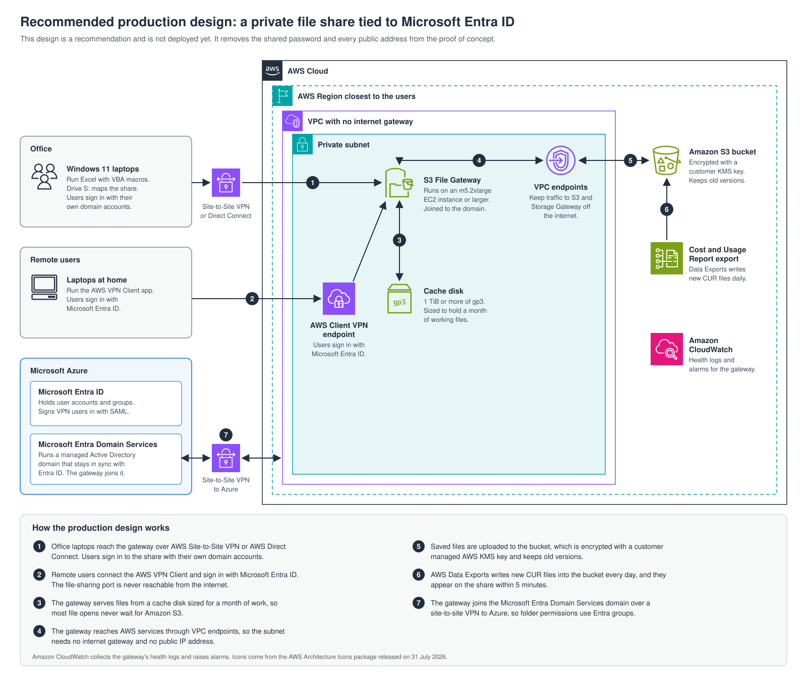

# Production Design

_DRAFT - For internal use only. Last modified: 2026-11-24 08:02 EST by mbitar._

This page describes the recommended changes for moving from the proof of concept to a production file share for the analysts. The design is a recommendation, and it has not been built or tested. The README has a [shorter comparison](../README.md#proof-of-concept-and-production) of the two designs.

[Back to the README](../README.md)

## What changes from the proof of concept

| Area | Proof of concept | Production |
|---|---|---|
| Status | Deployed and tested from a Mac, and removed on 23 November 2026. Excel on Windows 11 was not tested. See [Test results](test-results.md). | Not built or tested |
| Sign-in to the share | One shared guest password | Each user's own account, through the gateway's membership in a Microsoft Entra Domain Services domain |
| Folder permissions | Everyone can read and change everything | Windows folder permissions granted to Entra groups |
| Sign-in to the VPN | One shared client certificate | Microsoft Entra ID through SAML, so access is removed when the account is disabled |
| Remote access | All users connect through AWS Client VPN | Remote users connect through AWS Client VPN |
| Office access | Not set up | AWS Site-to-Site VPN, or AWS Direct Connect when more bandwidth is needed |
| Public exposure | Public subnet, Elastic IP address, port 445 open only to the listed addresses | Private subnet with no public address and no internet gateway |
| Gateway traffic to AWS | Through the internet gateway | Through VPC endpoints for S3 and Storage Gateway |
| Outbound traffic from the gateway | All traffic is allowed | Only HTTPS to the VPC endpoints, and the DNS, sign-in and time traffic that the gateway exchanges with its domain controllers |
| Instance metadata service | Version 1 requests are accepted | Version 2 is required, if a test shows that the gateway still works with it |
| Encryption keys | AWS-managed keys | A customer managed AWS KMS key for the bucket and the disks |
| Gateway size | m5.xlarge with a 300 GiB cache | m5.2xlarge or larger with a cache of 1 TiB or more, sized to a month of working files |
| Logging | Off | Client VPN connection logs, VPC flow logs, CloudTrail data events for the bucket, and gateway health logs in CloudWatch |
| Alarms | None | CloudWatch alarms for gateway health, cache upload backlog and cache hit rate |
| Terraform state | Local file | Encrypted S3 bucket with versioning and locking |
| Monthly AWS cost | About $277 in fixed charges, with charges that depend on use extra | About $615 to $655 for 10 users, including typical use. Microsoft's charges for Entra Domain Services and the Azure VPN gateway are extra. |

The [costs page](costs.md#recommended-production-design) itemizes the production cost, and the [security page](security.md) explains the weaknesses that these changes fix.

## Microsoft Entra ID

S3 File Gateway can join only an Active Directory domain, so it cannot use Microsoft Entra ID directly. Microsoft Entra Domain Services provides a managed Active Directory domain that stays in sync with Entra ID. The gateway joins that domain over a site-to-site VPN between the AWS VPC and the Azure virtual network, and users sign in to the share with their usual work accounts.

The AWS VPN Client signs users in through Entra ID with SAML. An Entra administrator creates an enterprise application for AWS Client VPN, and the VPN endpoint's authorization rules then allow only members of the analysts' Entra group.

## Steps to build it

1. Enable Microsoft Entra Domain Services, and connect its Azure virtual network to a new AWS VPC with AWS Site-to-Site VPN.
2. Create the VPC with private subnets in two Availability Zones and no internet gateway. Add a gateway VPC endpoint for S3 and an interface VPC endpoint for Storage Gateway.
3. Create a customer managed KMS key, and use it for the bucket and the EBS disks.
4. Deploy the gateway in a private subnet, and activate it through the Storage Gateway VPC endpoint. Limit its outbound traffic as listed in the table above, and test it with version 2 of the instance metadata service required. Then join it to the domain.
5. Create the file share with Active Directory sign-in, and grant folder access to Entra groups.
6. Create the Client VPN endpoint with SAML sign-in through Entra ID, and connect the office with Site-to-Site VPN or Direct Connect.
7. Turn on logging, create the CloudWatch alarms, and move the Terraform state to an encrypted S3 bucket.
8. Run the [test plan](test-plan.md), adjusted for the production sign-in and network, before users move over. Its scenarios have not run yet.

## Longer-term improvement for very large CUR files

For workbooks with millions of rows, consider moving the heavy lifting out of Excel. Amazon Athena can query the CUR data in S3 directly, and Excel's Power Query can pull in only the summarized result. The file share then holds smaller summary workbooks, which removes the row limit and the cost of uploading huge files on every save. See [Pros and cons](pros-and-cons.md#recommendation).

---

_DRAFT - For internal use only. Proprietary and confidential. FPT owns this solution. See the [license](../LICENSE) and the [disclaimers](../DISCLAIMER.md)._
